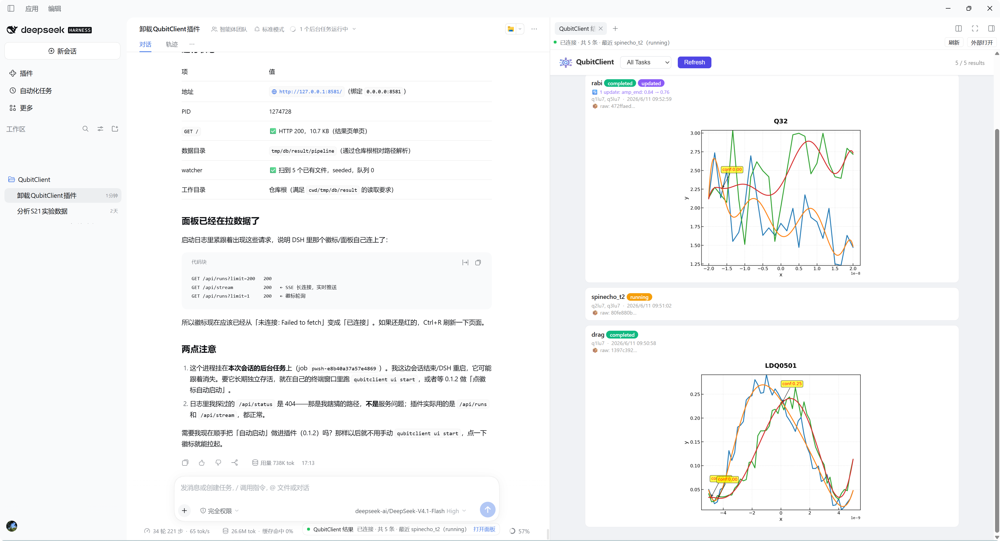

# QubitClient 结果面板（DSH 插件）

把 QubitClient 的结果页嵌进 DeepSeek Harness 右侧栏，并让模型直接读 pipeline 运行记录。

| 能力 | 说明 |
|---|---|
| 结果面板 | 右侧栏 tab「QubitClient 结果」：原样嵌入结果页（卡片流 / SSE / 详情） |
| 状态徽标 | 输入框下方显示服务在线状态、记录总数、最近一次任务；面板已打开时按钮变「聚焦面板」 |
| 模型工具 | `qubitclient_results`：按任务名与条数读取运行记录（任务、状态、比特、时间、图数、错误） |

- npm 包：`qubitclient-dsh-panel`
- 源码：`dsh-plugin/qubitclient-panel/`（QubitClient 本体无需改动）

## 效果



右侧栏是原样嵌入的结果页（任务卡片 + 曲线图，随服务端 SSE 实时刷新）；输入框下方那枚徽标显示服务状态，
点「打开面板」/「聚焦面板」在右侧栏开或聚焦这个 tab。

## 前置条件

| 步骤 | 命令 |
|---|---|
| 装结果页依赖（一次性） | `pip install -e ".[ui]"` |
| 启动结果页服务 | `qubitclient ui start`（默认 `http://127.0.0.1:8581/`） |

两条都在**仓库根**执行：读取侧固定按 `cwd/tmp/db/result` 取数，服务启动目录不对就看不到运行记录。

## 安装

```powershell
dsh plugin add qubitclient-dsh-panel
```

装完**重启 DSH**（Host 半只在主进程启动时加载），再 Ctrl+R 刷新页面。

## 验证

| 检查 | 预期 |
|---|---|
| 右侧栏「新建 tab」（罗盘）→「QubitClient 结果」 | 结果页嵌入显示 |
| 输入框下方徽标 | 「QubitClient 结果 · 已连接 …」 |
| 请模型调用 `qubitclient_results`（例如「只看 s21peakmulti 最近 3 条」） | 返回运行记录 |

## 配置

| 项 | 位置 |
|---|---|
| 服务地址（Host 工具用） | `qubitclient-panel/cordis.patch.yml` → `config.baseUrl`，默认 `http://127.0.0.1:8581` |
| 浏览器侧地址覆盖 | 离线提示里改地址后点「保存并重试」，记在 localStorage |

## 卸载

```powershell
dsh plugin remove qubitclient-dsh-panel
```

再从 profile 的 `dsh.profile.bundles` 里删掉 `qubitclient-dsh-panel`（或在 DSH「插件」页取消勾选），同样要重启 DSH。

## 开发自检

不安装、不重启就能跑：

```powershell
node dsh-plugin/scripts/check-plugin.mjs       # 子包
node dsh-plugin/scripts/check-plugin.mjs .     # 仓库根清单
```

## 常见问题

| 现象 | 处理 |
|---|---|
| 面板显示「结果页服务未连接」 | 仓库根执行 `qubitclient ui start`；也可在面板里改地址后「保存并重试」 |
| 换了端口 | 改 `cordis.patch.yml` 的 `config.baseUrl`，面板里再改一次地址，重启 DSH |
| 面板里看不到今天的运行 | 服务进程的工作目录不是仓库根 |
| 装了但重启没出现 | profile 的 `dsh.profile.bundles` 里缺 `qubitclient-dsh-panel` |
| 面板不跟随明暗主题 | 有意为之：保持结果页自己的样式 |
